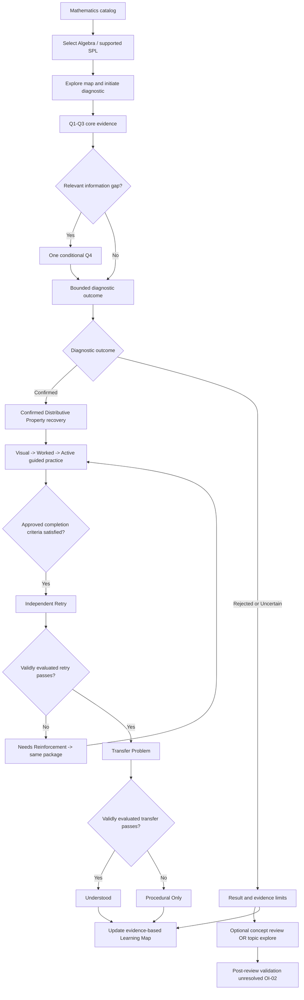

# Rethink — MVP Scope, Behavioral Definition & Boundaries

> **Authority:** approved PRD v1.0 source: original PDF pp. 10–12 and 40–51, supported by pp. 18–22, 52–57, 85–88, 99–103. This is a navigation-ready restatement; unresolved operational choices are **not** silently finalized. All capabilities are logically defined, not guaranteed implemented.

## 1. MVP contract

Rethink MVP demonstrates **one complete evidence-grounded conceptual recovery loop**, not a broad mathematics education application. The learner selects **Sistem Persamaan Linear (SPL)** under **Algebra** as the supported topic. The single supported diagnostic and recovery concept is **Distributive Property** (property of distribution in algebra). Assess it in (a) isolated algebraic applications and (b) transformation within SPL; both yield evidence about the **same concept**, not separate diagnosed competencies or blockers.

The MVP must prove a structurally reusable, controlled C1–C5 pathway with correct non-confirmed/uncertain branching. *Feature shown in navigation* is not the same as *feature supported*. No broad diagnosis, no total SPL proficiency score, no complete curriculum, no full adaptive tutoring or long-term retention claim.

### Essential domain distinctions

| Term | Meaning | Must NOT be confused with |
|---|---|---|
| Subject | E.g. Algebra | A diagnosed concept |
| Topic | E.g. SPL — diagnostic entry/context | A fully supported course or “mastered” content |
| Concept | E.g. Distributive Property | A complete learning topic or separate learner competency |
| Curated relationship | Reviewed mathematical prerequisite/reference link | Evidence that a particular student is weak |
| Represented | Exists as structural content for navigation | Active capability |
| Configured | Has some defined assets or metadata | Approved and released capability |
| Actively Supported | Explicitly enabled and content/assessment-ready in current scope | Everything present in graph |
| Diagnostic outcome | Confirmed / Rejected / Uncertain for supported blocker | Learner understanding state |
| Learning completion | Student finished guided activities under defined criteria | Independent concept comprehension |
| C5 learner state | Understood / Procedural Only / Needs Reinforcement | SPL topic mastery |

## 2. Complete approved capabilities

### C1 — Learning Entry & Topic Discovery

- Catalog-first mathematics entry; grouping by subject and topic.
- Algebra represented; SPL found under Algebra.
- Students can distinguish actively supported vs represented/unavailable topics; unsupported topics indicated **unavailable**, never falsely “locked because of ability/level.”
- SPL selection preserves diagnostic topic context and may initiate an eligible diagnostic session; unsupported topics cannot.
- Different levels of navigation may share screens; separate page for every subject/topic is not required.
- No unapproved personalized topic ranking or unsupported course navigation.

**Applicable FR:** FR-C1-01..05; source pp. 61–63.

### C2 — Hybrid Learning Map

- **Explore:** before diagnosis, orient users to curated topic-concept relationships. No student weakness/mastery indicators based only on graph presence.
- **Focus:** after diagnosis, display the investigated concept and distinguish *confirmed evidence* from *rejected/inconclusive outcome*. Optional review concept visibility does not imply Confirmed.
- **Progress:** after valid C5 knowledge validation, display the C5 concept-level outcome for Distributive Property only.
- Graph contains reusable content separately from support status and learner-specific evidence. C2 is a projection; C3/C5 remain authorities on diagnosis/learner state.
- No automatic prerequisite tracing or inferred grades/mastery from adjacency.

**Applicable FR:** FR-C2-01..05; FR-X-03; source pp. 64–65.

### C3 — Targeted Diagnostic Assessment & Outcomes

- Run within selected SPL context; evaluate only Distributive Property supported blocker.
- Administer exactly the three **core** questions: Q1/Q2/Q3; at most one relevant optional Q4; source examples are **illustrations, not finalized question bank**.
- Preserve raw submitted response, relevant question role and mathematical context; evaluate available evidence without using correctness alone as confirmation.
- Synthesize supporting, counterevidence, and insufficient/ambiguous evidence across questions.
- Produce *Confirmed*, *Rejected*, or *Uncertain* **only under the final applicable diagnostic policy**; division of AI and rule authority **OI-01 OPEN**. Formal all-correct mapping **OI-03 OPEN**.
- Explain which concept was examined and assessment limits; do not attribute other causes or confer SPL mastery.
- Confirmed → supported targeted recovery. Rejected/Uncertain → topic exploration and/or Optional Concept Review with explicit non-confirmed wording; do not convert to confirmed diagnosis through review.

**Applicable FR:** FR-C3-01..10; source pp. 66–71.

### C4 — Targeted Guided Learning

- Provide one **curated** Distributive Property package used by both confirmed recovery and optional review.
- Fixed instruction: **Visual Explanation → Worked Example → Partial Guided Practice**.
- Visual explanation conveys conceptual meaning (e.g. multiple groups / distribution), not only a memorized rule.
- Worked example includes mathematically valid transformations and explanations of significant steps, not merely final answer.
- Partial Guided Practice requires **at least one active mathematical response** completing a step or explaining reasoning. Avoid completion-by-observation.
- Preserve entry origin: `confirmed_recovery` vs `optional_review`. A review is not an updated diagnosis.
- Distinguish activity completion from understanding: C4 cannot generate C5 states.
- Exact feedback, wrong-attempt processing and completion rule **OPS-01/02 PENDING**; post-review validation eligibility **OI-02 OPEN**.

**Applicable FR:** FR-C4-01..08; source pp. 72–75.

### C5 — Knowledge Validation & Learning Outcomes

- On eligible **completed confirmed recovery**, offer an **Independent Retry** for the concept: no provided visual explanation, worked solution or partially completed assistance; preserve structure while changing example.
- Only **after valid successful retry**, offer a **Transfer Problem**: same underlying mathematical structure in meaningfully different wording/representation/context. Merely changing numbers is not sufficient transfer design.
- Assess each response using curated mathematically valid criteria; do not convert unintelligible/empty/equivalent responses to failure without OPS-03.
- Assign **one of three C5 states** only after applicable item-level evaluation. Communicate its *concept-level* meaning and confidence limitations, not a broad SPL understanding claim.
- Needs Reinforcement → same Guided Learning package; no new concept diagnosis, no adaptive prerequisite exploration.
- C5 is not a second diagnosis engine. Do not claim failed retry implies a newly found misconception.
- Optional Review route into validation **OI-02 OPEN**.

**Applicable FR:** FR-C5-01..08; source pp. 76–80.

## 3. Diagnostic blueprint Q1–Q4 (immutable source limits)

| Item | Role | Input format | Intended evidence | Caveats |
|---|---|---|---|---|
| **Q1** | Target Performance: SPL | Single-answer multiple-choice | Performance on selected target topic; meaningful distractors possible | Final correctness alone not enough to confirm blocker |
| **Q2** | Isolated Prerequisite Application | Short mathematical expression/step | Observable Distributive Property transformation | Transformation evidence not full mastery |
| **Q3** | Conceptual Reasoning | Short reasoning/explanation | Explanatory evidence beyond answer correctness | Reasoning may be ambiguous; AI interpretation constrained |
| **Q4** | Conditional probe only if information gap | Procedural Trace **OR** Conceptual Probe | Evidence for discriminating hypothesis/counterevidence | At most one, non-recursive, not for everyone |

**Total ≤4 items.** Q1–Q3 are core; Q4 is optional. PDF p. 10 has **illustrative, nonfinal** prompts such as direct expansion `3(x+2)` and explanation of why `2(x+3)=2x+6`; do not assume those exact questions, distractors or rubrics are approved OPS-04. Student answer correctness is **outcome evidence**; a visible operation is **transformation evidence**; verbal reasoning is **explanatory evidence**. For diagnosis, consider observation, interpretation, alternative causes, and how different questions relate. Classifications must be conservative.

### Supported outcomes

| C3 result | Meaning | Acceptable communication/next step | Never infer |
|---|---|---|---|
| **Confirmed** | Available evidence sufficiently supports Distributive Property blocker by applicable policy | Offer curated confirmed recovery | Permanent misconception, mastery of SPL or all mathematical gaps |
| **Rejected** | Sufficient evidence does not support/contradicts examined blocker by applicable policy | Communicate limits; optional concept review or topic exploration | No other difficulties exist |
| **Uncertain** | Insufficient/ambiguous/inconsistent evidence | Explicitly inconclusive, optional concept review or topic exploration | Definitive weakness or achievement |
| **All-correct core pattern** | **OI-03 OPEN** | Product decision needed for formal mapping, message and route | Automatic Rejected/Understood/SPL mastery |

Do not confuse `Rejected` with a mathematical guarantee of prerequisite proficiency; it is scoped to one investigated blocker and evidence.

## 4. Guided learning content expectations

### Visual Explanation
Conceptual, mathematically valid relationship; help learner see why distribution works. A representation of `3(x+2)` as 3 groups of `(x+2)` is a **concept example**, not a mandated final artifact. Ensure concept, graphics and symbolic rendering are mathematically consistent.

### Worked Example
Curated multi-step solution with a rationale for every meaningful transformation. Connect conceptual representation with symbolic operation. Does not only display the final answer.

### Partial Guided Practice
Guided, incomplete mathematical work where student supplies at least one actual expression, step or justification. Work must be assessed/processed according to approved rules once OPS-01/02 are resolved. Completion cannot be inferred from navigating through screens alone if active response requirement unmet.

The instructional path is **linear**. It may allow revisiting earlier material; this is not the same as generating a new adaptive instructional branch.

## 5. Knowledge Validation decision matrix

Only apply after assessment responses are validly evaluated against approved curated math assets.

| Independent Retry | Transfer | C5 state | User interpretation | Follow-up |
|---|---|---|---|---|
| **Fail** | **Not administered** | **Needs Reinforcement** | Independent use not demonstrated in tested task; transfer not evaluated | Revisit same supported package |
| **Pass** | **Fail** | **Procedural Only** | Independent operation demonstrated, transfer task unsuccessful | Explain limited evidence without false generalization; no forced repeated transfer loop |
| **Pass** | **Pass** | **Understood** | Independent and transfer performance demonstrated within assessed Distributive Property task(s) | Show blocker-level progress, not SPL mastery |
| **Missing/uninterpretable** | N/A | **No approved automatic mapping** | Requires OPS-03 | Resolve evaluation/UX behavior before acceptance |

**Do not label non-administered transfer as failed transfer**. The source three-state matrix is not a probabilistic mastery model, a long-term retention claim, or an unbounded learner classification. Successful supported item results are evidence limited by the coverage and quality of those tasks.

## 6. User journey and branch handling

**Diagram interpretation:** The conceptual diagram shows known paths; it is **not** a final state-machine or resolution of OI/OPS. An all-correct diagnostic outcome is OI-03; failed or uninterpretable item responses may require OPS-03; exact progress rules remain OPS-05. The diagram does not assert that optional review can run C5.

## 7. Future-ready structure: constraints F1–F4

- **F1 Reusable Concept Relationships:** topic–concept reference links can be shared across topics without duplicating concept definitions. No Neo4j requirement or adaptive prerequisite traversal implied.
- **F2 Explicit Support Boundaries:** distinguish represented, configured and actively supported at per-capability level. Turning on a graph node never activates diagnosis/learning/validation.
- **F3 Separable Assessment & Recovery Definitions:** reusable concept identity separate from diagnostic items and curated instructional & validation materials; no full CMS or automatic question generator required.
- **F4 Evidence-Bounded Learner State:** any reported understanding state must remain tied to tested concept and applicable evidence, not curricular associations or lesson completion.

The source's PRD conceptual architecture states **five logical information domains** (see `../technical/architecture.md`). These are model boundaries, not necessarily physical databases/services.

## 8. Explicit exclusions E1–E5

| ID | Out of MVP | Clarification |
|---|---|---|
| **E1** | Expanded mathematical coverage, comprehensive SPL course, multi-blocker completed recovery | Only one Distributive Property blocker fully supported |
| **E2** | Computerized adaptive testing, probabilistic mastery, unrestricted misconception diagnosis, arbitrary AI blocker creation | Conditional Q4 **is** still in scope |
| **E3** | Dynamic scaffold selection, competency-specific branches, multi-layer prerequisite tracing | Curated *linear* scaffold **is** in scope |
| **E4** | Comprehensive topic mastery assessment, adaptive repeated validation, long-term retention monitoring | Retry + conditional transfer **are** in scope |
| **E5** | Unlimited conversational tutoring, AI-generated full lessons, LMS-grade tracking | Hybrid Map and bounded optional review **are** in scope |

Future readiness does not authorize new features. Requested expansion needs a separately approved scope decision and curated math validation.

## 9. Cross-capability invariants (FR-X)

- **FR-X-01:** retain SPL selected topic, Distributive Property concept, diagnostic evidence source and whether learning originated in confirmed recovery or optional review.
- **FR-X-02:** eligibility-gated transitions preserve status: rejected/uncertain are not confirmed; topic selection/lesson start isn't enough for C5; post-review path still OI-02; all-correct mapping OI-03.
- **FR-X-03:** a displayed map state or diagnostic/learning-result label must match the same evidence and authoritative source. Understood cannot appear because C3 was Confirmed or because C4 was completed.

**Ownership rule IP-01:** C3 owns diagnosis, C4 participation/completion, C5 learner state, C2 projection. **IP-02:** catalog/map presence ≠ active capability or evidence of personal understanding.

## 10. Integration verification categories V-X-01..08

| ID | Test intent | Known qualification |
|---|---|---|
| V-X-01 | Successful confirmed recovery end-to-end | Requires approved content/decision criteria |
| V-X-02 | Rejected/Uncertain continuation | Must preserve non-confirmed meaning |
| V-X-03 | Retry fails | No transfer; Needs Reinforcement; same package |
| V-X-04 | Retry pass + transfer fails | Procedural Only |
| V-X-05 | Both pass | Understood scoped to blocker |
| V-X-06 | Unsupported concept/topic limits | No hidden enabled diagnosis/recovery/validation |
| V-X-07 | All core answers correct | **Blocked by OI-03** |
| V-X-08 | After Optional Concept Review | **Blocked by OI-02** |

These are source-provided initial **verification categories, not final executable test scripts**. Tests need approved mathematical fixtures and expected behaviors. Additional testing of AI invalid output and uninterpretables needs careful handling under OI-01 / OPS-03.

## 11. Dependencies preventing invented completion

- **OI-01:** precise AI/math/rule authority and diagnostic decision policy.
- **OI-02:** validation eligibility and learner-state update after Optional Concept Review.
- **OI-03:** how all-correct diagnostic responses are classified and routed.
- **OPS-01:** feedback/retries for partial guided practice.
- **OPS-02:** exact lesson-completion evidence/threshold.
- **OPS-03:** parsing/ambiguity/equivalence/blank validation responses.
- **OPS-04:** finalized, mathematically reviewed Q1–Q4, visual/example/practice/retry/transfer and rubrics.
- **OPS-05:** actual cross-capability transitions, session state and persistence design.

All are unresolved in source. See [`../decisions.md`](../decisions.md). **This document cannot be used to declare their final answer.**
