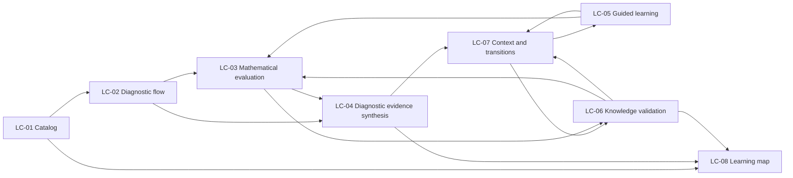

# Rethink — Conceptual & Technical Blueprint for MVP Engineering

> **Later implementation decisions (23 October 2026):** the user explicitly approved OI-01..03 and OPS-01..05 implementation rules, including all-correct → Rejected and no C5 after Optional Review. See [current decision record](../decisions.md#current-implementation-decisions--23-october-2026) and [concrete operational contract](../implementation/MVP-COMPLETION.md). Original source-status statements and FR wording below are preserved; implementation approval does not establish expert mathematics, usability or learning-effectiveness acceptance.

> **Document status:** Source-faithful engineering handoff, **not** an approved physical implementation. Derived from original PDF pp. 85–88 (conceptual architecture), 98–103 (implementation objectives & authority), 104–108 (components), 109–117 (process workflows), 118–126 (data, AI, methods), 127–133 (readiness & governance). Tech choices from paper are explicitly `PAPER-PROPOSED`, not locked. OI-01–03 and OPS-01–05 remain unresolved. See `../decisions.md`.

## 1. Purpose, applicability and source precedence

Translate the approved C1–C5 and FR-X product obligations into **logical responsibilities, information flow, evidence ownership, and engineering design constraints**. This document does **not** define microservice topology, deployment provider, database ERD, transport protocol, versioned API, final LLM/model, final prompt, persistence rules, or an implementation already completed.

**Source hierarchy:** Overall Approved PRD v1.0 and individual approved 39 FRs are authoritative for scope and behavior; the research paper supports methodology and suggests a technical approach; older design references provide context; this Technical Blueprint guides design but cannot override approved product decisions. Engineering alternatives are permitted if product behavior remains aligned and deviations are documented. Product-affecting changes require review.

### Technical implementation objectives

1. **Integrated recovery:** Deliver an end-to-end supported loop, not independent demos that break shared context.
2. **Evidence-grounded evaluation:** Keep actual answer, valid math observation, diagnostic interpretation and final policy outcome distinguishable.
3. **Controlled instruction:** Curated Visual → Worked → Active partial guided sequence.
4. **Consistent context:** Preserve SPL selected topic, Distributive Property support, entry origin, completion, results and transition eligibility.
5. **Verifiable product behavior:** Every FR and relevant verification scenario can be checked against reviewed cases; demo ≠ approval.

### Supported vertical slice

| Domain item | Bound |
|---|---|
| Mathematics | Algebra, selected diagnostic topic SPL |
| Active blocker / recovery concept | Distributive Property only |
| Assessment | Core Q1 SPL MCQ, Q2 math expression, Q3 reasoning; max one Q4 if needed |
| Diagnosis result | Confirmed / Rejected / Uncertain (policy detail OI-01, all-correct OI-03) |
| Learning | One curated linear package + optional non-confirmed review |
| Validation | Retry without scaffold → different-context transfer only if passed |
| Learner state | Understood / Procedural Only / Needs Reinforcement from valid C5 evidence |
| Map | Explore / Focus / Progress projection only |

## 2. Conceptual information architecture: five domains (PRD Section 07)

| Domain | Contents and responsibility | Anti-confusion invariant |
|---|---|---|
| **Conceptual Knowledge Structure** | Subject, topic, concept and reviewed prerequisite/association relationships | Not a personal learner profile or automatic diagnosis |
| **Assessment Definitions** | Diagnostic task roles, questions, evidence expectations, evaluation criteria | Assessment availability not guaranteed by graph relationship |
| **Instructional & Validation Content** | Curated visuals, worked examples, active practice, retry and transfer tasks | Completing an activity is not validating conceptual understanding |
| **Capability Availability** | Which diagnosis/recovery/validation resources are represented/configured/actively enabled | Represented/configured ≠ supported/active |
| **Learner Evidence** | Responses, mathematical observations, diagnostic result, participation/completion, C5 validation status | Learner state is tied to evaluated responses, not a concept definition |

These are **logical information responsibilities**, not a prescription for five databases. Reusable concept IDs (or equivalent relationships) should keep mathematical concepts separate from topic references and independently configurable support. A concept can be displayed but unavailable for assessment. Conceptual scalability means maintainability/extensibility, not measured production scalability. Reference the original source if an architecture design goes beyond this boundary (pp. 85–88).

### Capability activation discipline

`Represented` = concept exists in curated knowledge → navigation/graph allowed. `Configured` = some metadata or assets exist → activation is not implied. `Actively Supported` = explicit operational support and reviewed data for the capability within approved scope → action may run. Support should be evaluated **per capability** (diagnosis, learning, validation), not a single global “topic available” flag that accidentally unlocks all flows.

**Source-derived foundations:** F1 reusable relationships, F2 explicit support boundaries, F3 separable concept/assessment/learning assets, F4 evidence-bounded learner state. A graph database, curriculum builder and generalized question-authoring UI are not mandated.

## 3. Eight logical components LC-01–LC-08

| ID | Logical component | Responsibility | Inputs (conceptual) | Outputs | PRD mapping |
|---|---|---|---|---|---|
| **LC-01** | Learning Entry & Catalog | Catalog/relationships/support availability, diagnostic entry eligibility | Curated catalog, topic-concept relationships, capability support | Selected supported topic context | C1, F1–F2 |
| **LC-02** | Assessment Flow Controller | Core Q1–Q3, conditional max one Q4, response capture and item context | Topic, diagnostic blueprint, curated questions, student submissions | Attributable assessment responses | C3 |
| **LC-03** | Mathematical Evaluation Support | Correctness, transformations, evaluation against math references | Raw responses, reference solutions, rubrics | Item-level math observations/evaluations | C3, C5 |
| **LC-04** | Diagnostic Interpretation & Decision Support | Cross-question evidence synthesis; coordinate supported diagnosis | Mathematical observations, reasoning, supported error/diagnostic knowledge | Confirmed/Rejected/Uncertain and evidence basis, under OI-01 | C3, OI-01 |
| **LC-05** | Guided Learning Controller | Curated lesson sequencing, active practice interactions, completion | Learning-entry origin, supported concept/package, student actions | Participation evidence, completion, handoff context | C4 |
| **LC-06** | Knowledge Validation Controller | Retry, conditional transfer, three-state mapping | Eligibility, curated C5 tasks, mathematical result | Understood/Procedural Only/Needs Reinforcement | C5 |
| **LC-07** | Session & Transition Coordination | Maintain context and enforce valid transitions | Topic, diagnosis outcome, learning origin/completion, validation | Transition eligibility and consistent workflow state | FR-X-01..03 |
| **LC-08** | Learning Map Projection | Render Explore, diagnostic Focus, validation Progress | Curated graph, availability, C3 outcome, C5 state | Evidence-bounded map representation | C2 |

**Important:** LC-01..LC-08 are logical owners, **not** eight mandatory separately deployed services. The PDF includes `[DIAG-01]` as an *unproduced placeholder*, not an authoritative diagram. The architecture below is a reader aid derived from component ownership, not a sourced approved physical topology.

### Ownership invariants

- **LC-03:** can produce mathematical evaluation/observations; must not independently **confirm** blocker.
- **LC-04:** owns logical interpretation/outcome coordination; **final decision authority still OI-01 Open**.
- **LC-05:** owns teaching participation/completion; **cannot assign Understood**.
- **LC-06:** owns C5 state from **valid** retry/transfer results; cannot diagnose new blocker.
- **LC-07:** owns routing/eligibility, not new diagnostic/mathematical judgments.
- **LC-08:** renders results of domain owners; must not infer student weaknesses from graph edges.

## 4. Cross-component logical information contracts (not JSON/API schemas)

| Information/decision | Owner | Typical consumers | Non-negotiable integrity rule |
|---|---|---|---|
| Topic and active capability availability | LC-01 | LC-02, LC-08 | Listed concept does not auto-enable diagnosis |
| Student assessment responses | LC-02 | LC-03, LC-04 | Raw response, item role and interpretation remain distinguishable |
| Mathematical evaluation/observations | LC-03 | LC-04, LC-06 | Item score/observation ≠ final diagnosis or learner state |
| Diagnostic outcome | LC-04, under OI-01 | LC-05, LC-07, LC-08 | Three outcomes only for supported blocker |
| Participation / instructional completion | LC-05 | LC-06, LC-07 | Completion ≠ Understood |
| Knowledge Validation learner state | LC-06 | LC-07, LC-08 | Approved three-state matrix + evidence scope |
| Transition eligibility | LC-07 | Flow controllers | Based on origin/outcome/completion/approved routing |
| Learning map representation | LC-08 | Learner UI | Projection must never change source state semantics |

**Conceptual information integrity:** evidence and decision separation; explicit owners; context continuity; no implicit state promotion; dependency-aware integration. Physical storage and transport are engineering choices. If a proposed interface combines ownership in code, maintain logical separations for reasoning/testability.

## 5. Core diagnostic workflow D1–D7

| Stage | Owner | Work | Expected output |
|---|---|---|---|
| **D1** Assessment Initialization | LC-01/02 | Verify SPL actively supported, retrieve approved blueprint | Valid session/topic context |
| **D2** Core Question Administration | LC-02 | Present Q1 target MCQ, Q2 isolated math response, Q3 conceptual explanation | Response evidence tagged to roles |
| **D3** Mathematical Evidence Evaluation | LC-03 | Evaluate correctness, transformations and relevant reasoning | Item-level observations |
| **D4** Cross-Question Evidence Synthesis | LC-04 | Consider supporting, counter and missing/ambiguous evidence | Evidence summary for candidate blocker |
| **D5** Conditional Probe | LC-02/04 | If relevant information gap, present **max 1** Q4 Procedural Trace OR Conceptual Probe; evaluate it | Additional observations |
| **D6** Diagnostic Finalization | LC-04 under OI-01 | Apply final **approved** policy when known; don't force uncertainty into confirmation | Confirmed/Rejected/Uncertain |
| **D7** Result + Handoff | LC-07/08 | Explain scope/limits; route according to outcome; project map | Valid continuation context |

**Source decision rules D-R01..08:** supported concept only; one error insufficient; synthesize across questions; max one probe; 3 outcome labels; ambiguous → no unsupported confirmation; AI bounded to supported diagnostic knowledge; no SPL mastery inference.

**Unresolved:** OI-01 final authority and algorithm, OI-03 all-correct pattern, OPS-04 finalized math questions/rubrics. Assessment scaffolding/recording can be planned without finalizing these questions. Source diagram `[DIAG-03]` is a **placeholder**.

## 6. Guided Learning workflow L1–L7

| Stage | Owner | Required operation |
|---|---|---|
| **L1** Learning Entry Context | LC-07 | Distinguish Confirmed Recovery from Optional Concept Review (non-confirmed) |
| **L2** Curated Package Retrieval | LC-05 | Load single supported Distributive Property package |
| **L3** Visual Explanation | LC-05 | Show mathematically valid conceptual representation |
| **L4** Worked Example | LC-05 | Show meaningful solution transformations **with reasons** |
| **L5** Partial Guided Practice | LC-05 + LC-03 as needed | Student provides active mathematical/reasoning response |
| **L6** Completion Evaluation | LC-05 | Assess approved completion criteria (currently OPS-02 pending) |
| **L7** Learning Continuation | LC-07 | Apply context, completion and eligibility; optional-review C5 OI-02 open |

**L-R01..07:** one curated package; linear sequence; active response required; no adaptive orchestration; optional review does not alter diagnosis; completion does not prove understanding; confirmed eligible completion can enter C5 while optional review eligibility is pending.

**Open:** OI-02, OPS-01, OPS-02, OPS-04, OPS-05. `[DIAG-04]` appears as an unbuilt source diagram placeholder.

## 7. Knowledge Validation workflow V1–V7

| Stage | Owner | Required operation |
|---|---|---|
| **V1** Eligibility | LC-07 | Check completed confirmed recovery or a later explicitly approved alternative |
| **V2** Independent Retry | LC-06 | Present same mathematical concept/structure unscaffolded |
| **V3** Retry Evaluation | LC-03 | Evaluate math response against reviewed reference |
| **V4** Conditional Transfer | LC-06 | Present only after evaluated successful retry; new representation/context |
| **V5** Transfer Evaluation | LC-03 | Evaluate meaningful application of same concept in new form |
| **V6** Learner-State Determination | LC-06 | Apply approved three-result matrix **only with valid item outcomes** |
| **V7** Result & Continuation | LC-07/08 | Display concept-level state, route reinforcement and map progress |

| Retry | Transfer | State | Implication |
|---|---|---|---|
| Fail | Not administered | **Needs Reinforcement** | Return same package, no re-diagnosis |
| Pass | Fail | **Procedural Only** | Independent procedure passed; transfer did not |
| Pass | Pass | **Understood** | Supported independent and transfer evidence |

**V-R01..08:** valid eligibility; no scaffold; meaningful representation change; transfer gate; exact state matrix; same package reinforcement; no fresh diagnosis; claims bounded to Distributive Property not SPL. The matrix must not be applied to unreviewed/blank/uninterpretable answers without OPS-03. **OI-02** pending for Optional Review validation. **OPS-02/03/04/05** pending for eligible complete work, grading, content and transitions.

## 8. Cross-capability transition T1–T7 and integrity rules

| Transition | Source trigger | Allowed precondition / unresolved |
|---|---|---|
| **T1** Entry → Diagnosis | User starts SPL diagnostic | Active supported topic, valid blueprint |
| **T2** Diagnosis → Confirmed Recovery | Supported Confirmed result | Final C3 authority subject to OI-01 |
| **T3** Diagnosis → Optional Review | Rejected/Uncertain and student opts in | Must preserve non-confirmed origin |
| **T4** Confirmed Recovery → Validation | C4 finished | Approved completion + eligible C5 |
| **T5** Optional Review → Validation | Optional review finished | **OI-02 OPEN — do not silently enable** |
| **T6** Validation → Reinforcement | Retry failed | Needs Reinforcement; existing C4 package |
| **T7** Outcomes → Learning Map | Source owner publishes C3/C5 result | Projection only; evidence/source consistency |

**T-R01..06:** maintain selected topic, assessed concept, diagnostic outcome and original learning context; transition controller doesn't synthesize evidence/assign states; evidence can be traced; no Confirmed/Completed → Understood shortcut; no unsupported capability unlock; unresolved route cannot be declared final. OI-03 also governs all-correct C3 path. The original `[DIAG-02]` figure is still a **placeholder**.

### Integration failure hazards to test

- User tries to start unsupported topic: C1 blocks without false mastery/lock signal.
- “Confirmed” without adequate evidence: prevented or flagged; OI-01 review needed.
- Uncertain/Rejected user starts shared content: preserve `optional_review` origin and non-confirmed map focus.
- Learner jumps directly to C5: deny until approved eligibility, except explicitly reviewed behavior.
- Retry fails: transfer **never** administered; user returns to same guided package.
- Returning or retrying content: ensure response and state provenance aren't retroactively rewritten.
- Async/failure AI response: no fabricated “valid” diagnostic result.
- Map progress: only after C5 valid response and result, no independent C2 invention.

Specific technical error states, event queues, partial-resume policy and authoritative operational state machine are **proposals awaiting OPS-05**, not asserted source behavior.

## 9. Logical data asset inventory (not an ERD)

| Category | Expected information | Typical owner/reader |
|---|---|---|
| Topic/concept knowledge | Subject, topic, concept, prerequisite links and support flags | LC-01, LC-08 |
| Diagnostic knowledge | Supported blocker, known error patterns, criteria, coverage | LC-03/04 |
| Assessment assets | Q1–Q3 and optional Q4, answers/roles/metadata | LC-02/03/04 |
| Guided learning assets | Conceptual visual, worked examples, partial active practice, criteria | LC-05/03 |
| Validation assets | Retry item, meaningfully different transfer, concept structure, scoring | LC-06/03 |
| Learner evidence | Raw responses, observation, reasoning interpretation, C3 outcome, participation/completion, C5 learner state | LC-03..08 as relevant |
| Session/transition context | Selected topic, supported concept, entry origin, eligibility and applicable results | LC-02, LC-05..08 |

**Curated package minimum:** reviewed Q1–Q4 candidates and answer/rubrics; Distributive Property pattern knowledge; mathematically valid visual; multi-step example reasoning; active partial practice; unscaffolded independent retry; meaningful different representation transfer; item-level success criteria. None of the sample equations in PDF alone constitute **approved OPS-04 final question bank**.

### Evidence integrity

Treat these as conceptually separate: **raw response → mathematical observation/evaluation → bounded reasoning interpretation → final diagnostic policy outcome → C4 participation/completion → C5 assessed outcome**. Retain provenance with concept, item role, session and relevant stage. An unassessed concept has *no learner-state judgment*. Source does **not** mandate a certain persistence layer, retention period, or event-sourcing framework.

## 10. Methodological and AI boundaries

### 10.1 Evidence-Centered Design (ECD) adaptation

Source proposes *Claim → Evidence → Task → Interpretation → Verification* informed by ECD. The Student Model is a hypothesis about **Distributive Property**, not a global score. Task Model relates to evidence roles Q1–Q4. Evidence Model records outcome/transformations/explanations. Cross-question synthesis considers supporting, contradictory and insufficient data. Verification uses reviewed reference cases.

**Do not claim** full ECD statistical measurement models, DINA implementation, Rule Space inference, calibrated mastery probabilities, or broad CDM reliability unless actually implemented and independently established.

### 10.2 Observation / interpretation / inference distinction

Example (illustrative): user submits `3(x+2) = 3x+2`.
- **Observation:** the user wrote a transformation with an unchanged constant.
- **Interpretation:** pattern is *consistent with* partial distribution.
- **Diagnostic inference:** only additional/combined relevant evidence under an approved policy may support an outcome. A single wrong transformation is not sufficient by default; other causes and contradictions must be evaluated.

Source references four possible dimensions: mathematical correctness, error characteristics, conceptual explanation and evidence clarity. Evidence directions include supporting, counterevidence and non-specific/insufficient. LLM may interpret and synthesize **within bounds**, but OI-01 final allocation is open.

### 10.3 Paper-proposed hybrid architecture — do not treat as final

The paper proposed knowledge-graph curated relationships, structured rule-based orchestration, deterministic math verification and a constrained LLM supporting interpretation/feedback. Later product/technical documents describe **AI-assisted cross-question synthesis**, leaving final diagnostic decision authority explicitly unresolved as OI-01. **Do not resolve that tension by source cherry-picking.** Engineering must propose and test boundaries, then obtain appropriate review before final acceptance.

| Concern | Binding boundary | Engineering work still needed |
|---|---|---|
| Math correctness | Must be mathematically verifiable and consistent with reviewed references | Choose algebra checking approach; handle expression equivalence |
| Error pattern | Only curated supported blocker is diagnosable | Curate question-linked patterns and verify math |
| LLM reasoning | Context/evidence bounded; no unsupported blocker | Design prompt / input context / result validation under OI-01 |
| Cross-question synthesis | Consider counterevidence & ambiguous cases | Propose explicit decision policy and reference cases |
| Structured output | Invalid AI output must not masquerade as valid diagnosis | Typed schema, parser, retry/failure policy candidate |
| Guided learning | Linear curated assets | Build content interaction and feedback under OPS-01/02 |
| Knowledge Validation | Strict three-state matrix after valid grading | Approved OPS-03/04 needed |
| System failure | Must not translate failure into false learner claim | Safe error states / tests, design under engineering governance |

### 10.4 Paper-listed technology register — **PAPER-PROPOSED, NOT LOCKED**

| Role | Candidate mentioned in paper | Status |
|---|---|---|
| Frontend | Flutter | Paper-Proposed, replaceable |
| Backend/orchestration | FastAPI | Paper-Proposed, replaceable |
| Concept relationships | Neo4j | Paper-Proposed, replaceable if semantics preserved |
| Learner data | PostgreSQL | Paper-Proposed, replaceable |
| Mathematical verification | SymPy | Paper-Proposed, replaceable, must maintain verified math |
| AI output schemas | Pydantic | Paper-Proposed, equivalent allowed |
| LLM | DeepSeek-V4.1-Flash via API | Paper-Proposed, evaluate quality/cost/latency |
| Math visualization | JSXGraph / SVG / Canvas | Candidate options, not mandates |

No final decisions about actual runtime, model, data structure or infrastructure are asserted. When diverging from paper, record *reason, PRD impact, verification impact, approval status*.

### 10.5 Academic references and research datasets

Source registry includes: Mislevy, Almond et al. **ECD (2003)**; de la Torre **diagnostically designed MCQ options (2009)**; de la Torre **DINA model (2009)**; Tatsuoka **Rule Space (1983)**; Bastani et al. (2025) on potential harms from unguarded GenAI; research on visualizations, worked examples, scaffolding and transfer. These references are conceptual evidence sources **not** automatic implementation claims. Bibliographic details require verification against the original research paper / primary literature before scholarly citation.

**Deferred external datasets:** Eedi Misconceptions Graph; Eedi MAP; FoundationalASSIST. Potential future uses: concept–misconception relationships, explanations/error labels and response-pattern evaluation. **None are mandatory for MVP**. If adopted, first assess access, licenses, coverage, label quality, representativeness and math validity. Dataset inclusion does not automatically enable diagnoses outside Distributive Property.

## 11. Implementation readiness and verification

An engineering capability is ready for **verification** only if relevant product behavior is implemented, required curated assets exist, underlying decision policy is approved where needed, and expected outcomes can actually be evaluated. A UI demo and a single correct math example are insufficient.

### Verification preparation inventory

| Area | Expected evidence | Source alignment |
|---|---|---|
| FR traceability | Mapping of implementation to all 39 approved FRs | C1–C5, FR-X |
| Math validity | Curated inputs/accepted expressions, expected outputs, human math review | OPS-04 |
| Diagnostic decision integrity | Confirmed, Rejected, Uncertain, counterevidence and optional probing cases | C3, OI-01 |
| Guided learning | Visual/explanation validity, ordered stages, active practice/completion | C4, OPS-01/02 |
| Validation | Retry failure, transfer failure, both passed, missing/ambiguous handling | C5, OPS-03 |
| Cross-capability | Supported/rejected/uncertain routing, context continuity, map state | FR-X, V-X-01..08, OPS-05 |
| AI safety/reliability | Out-of-scope claims, invalid/malformed outputs, contradictory/math-incorrect interpretations, failures | OI-01, C3 |
| User experience | Task success and outcome comprehension, separate from functional testing | SC4 / D3 |
| Learning outcomes | Independent/transfer performance and appropriately designed evaluation | D4 |

**Source verification categories V-X-01..08** live in `../prd/mvp-definition.md` and `../prd/requirements.md`. Unapproved expected behaviors must not be marked passed. Status must distinguish test pass, failure, not tested and decision blocked.

## 12. Engineering decision / deviation governance

**Engineering authority:** Can choose frontend/backend/AI runtime/math engine/persistence/deployment and low-level design, as long as approved behavior is preserved and choices documented. Paper candidates are reference points, not mandatory commitments.

**Product review required when:** changing diagnostic authority/decision policy, learner-state matrix, coverage, eligibility, success interpretation, or approved FR obligations; closing OI/OPS as final; altering unsupported content activation semantics.

**Technical deviation record:** Decision ID; original paper/older reference; selected/proposed approach; rationale and impact; affected FR; verification consequences; approval/status. **Example:** relational database instead of graph database is permissible if concept relationship and capability activation semantics remain correct, but changing diagnosis policy requires product review even with unchanged database.

**Not supplied in original:** final ERD, API contract, backend technology decision, source code, deployment specifics, evaluation thresholds, accepted math items/rubrics, complete screen design, finished diagrams. Draft these as **proposals** and do not attribute them to the approved source baseline.

## 13. Operational blockers and handoff priorities

1. Curate and mathematically review **OPS-04** assets early (diagnostic prompts/distractors, accepted transformations and explanations, meaningful transfer examples, practice content).
2. Bring **OI-01** to product+AI/Math review; establish testable evidence/policy authority before final C3 acceptance.
3. Specify feedback/completion **OPS-01/02** without changing linear learning path.
4. Define C5 response grading and failure/equivalence **OPS-03**, keeping unanswered/uninterpretable separate from conceptual failure unless approved.
5. Resolve product routing **OI-02** (post-optional review) and **OI-03** (all-correct pattern).
6. Define coherent operational state/transition **OPS-05** with FR-X scenario verification; keep C2 a read-only projection of outcomes.
7. Verify all 39 FRs and SC1–SC3, then separately evaluate SC4 and possible learning outcome evidence. Build actionable engineering backlog separately.

**These priorities are derived implementation planning, not a declaration of approved sequencing, existing completed tasks or a new MVP scope.**

## Engineering implementation selection — 23 October 2026

The user selected an API-only Next.js backend hosted on Vercel, primarily serving the existing Swift app, and authorized removing the older broad website backend. Current physical module mapping, verification and removed scope are documented separately in [the implementation report](../implementation/BACKEND-REBUILD.md) and [DEC-2026-10-23-BACKEND](../decisions.md#dec-2026-10-23-backend--replace-legacy-backend-with-a-swiftvercel-recovery-api). This engineering selection implements the logical responsibilities above; it does not amend the source PRD, mandate the paper's candidate stack, resolve OI/OPS dependencies or prove a production deployment.
